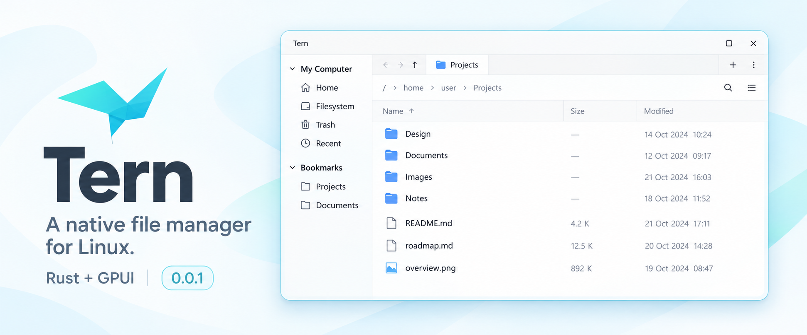

<p align="center">
  
</p>

<p align="center">
  <a href="https://github.com/CoolLoong/tern/actions/workflows/build.yml"></a>
  <a href="#getting-started"></a>
  <a href="docs/releases.md"></a>
  <a href="LICENSE"></a>
</p>

<p align="center">
  <a href="#features">Features</a> ·
  <a href="#getting-started">Get started</a> ·
  <a href="docs/file-chooser.md">File chooser</a> ·
  <a href="docs/architecture.md">Architecture</a> ·
  <a href="CONTRIBUTING.md">Contributing</a>
</p>

Tern is a native Linux file manager written in Rust and built with
[GPUI Kit](https://github.com/longbridge/gpui-kit). It brings tabs, familiar
file operations, local search and desktop integration into one GPU-rendered
application. Its interaction design takes inspiration from Nemo; reusable
components originate from [termua](https://github.com/iamazy/termua).

The banner is a designed preview based on Tern's interface, using sample files
and anonymous paths.

**Version 0.0.1 · Development preview.** The supported target is Linux x86_64 with a session
D-Bus and an X11 or Wayland desktop. Niri has dedicated activation and floating
file-chooser integration. Other compositors need their own window rules.

## Features

| Area | Available today |
| --- | --- |
| Browse | List and icon views, tabs, persistent workspace, navigation history, editable breadcrumbs |
| Find | Recursive local search, glob matching, hidden-file toggle, sorting and Recent files |
| Organize | Copy, move, rename, create folders/files, trash, restore, permanent deletion and archive creation |
| Inspect | Image/text preview, properties, MIME-based Open With and external terminal launch |
| Interact | Multi-select, marquee selection, drag and drop, keyboard shortcuts and context menus |
| Integrate | D-Bus single instance, FileManager1, resident tray icon and XDG FileChooser backend |

Directory enumeration, sorting and search run on background workers. Cancelled
or superseded jobs cannot publish stale results. Font metadata and GPU pipelines
are reused across starts/windows; see the [renderer patch notes](vendor/gpui-pre-wgpu/TERN_PATCHES.md).

## Getting started

### Build from source

Install [Rust through rustup](https://rustup.rs/). The repository pins the tested
toolchain in `rust-toolchain.toml` and dependencies in `Cargo.lock`.

On Ubuntu 24.04, install the native build dependencies:

```sh
sudo apt-get update
sudo apt-get install -y build-essential clang cmake lld pkg-config \
  libfontconfig-dev libfreetype-dev libwayland-dev libx11-xcb-dev \
  libxkbcommon-x11-dev libssl-dev libzstd-dev libvulkan1 dbus
```

```sh
git clone https://github.com/CoolLoong/tern.git
cd tern
cargo build --release --locked --bin tern
./target/release/tern
```

The build downloads public Rust dependencies. Running the application requires
a desktop session and a working GPU driver. `xdg-utils` provides the default
file opener; `zip` is optional for ZIP creation.

### Arch Linux package

Build from the repository root using the supplied local `PKGBUILD`:

```sh
makepkg --syncdeps --force
sudo pacman -U "$(makepkg --packagelist)"
```

This installs the executable, application icon, desktop entry and portal
activation files. Portal selection is an explicit desktop configuration step;
follow the [file chooser guide](docs/file-chooser.md). The recipe builds this
checkout; it is not an AUR source-download recipe.

### Open a location

```sh
tern ~/Downloads
tern --select ~/Documents/report.pdf
tern 'file:///tmp/example%20folder'
```

Launching without arguments activates an existing window. Paths open new
windows through the resident instance. Double-click the breadcrumb path to edit
it, or use `Ctrl+L`. Closing all windows leaves Tern in the system tray; choose
**Quit** from the application or tray menu to exit.

## Desktop integration

- **File manager:** `packaging/linux/tern.desktop` advertises directory handling.
  FileManager1 activation is opt-in to avoid taking over another file manager;
  see [desktop setup](docs/desktop-integration.md).
- **File chooser:** browser uploads and save dialogs use a separate portal
  process. On Niri, the supplied rule opens them in the floating layer.
- **Tray:** a StatusNotifierItem host is needed to display the resident icon.
  Running directly from a checkout does not install the `tern` icon into the
  desktop theme; package installation supplies it.

## Development and validation

```sh
cargo fmt --all -- --check
python3 tools/check-architecture.py
./tools/check-headless.sh
```

The headless script runs all workspace tests on an isolated D-Bus, plus the
vendored font-cache integration tests. GPUI tests use simulated windows.
Desktop variables are removed; no native windows are opened. These checks are
run locally. GitHub Actions builds Linux archives and can create a release draft
when explicitly requested; see [builds and releases](docs/releases.md).

See [CONTRIBUTING.md](CONTRIBUTING.md) for the complete checks and
[tools/README.md](tools/README.md) for optional desktop benchmarks. Headless
correctness tests do not establish first-paint latency or GPU-driver compatibility.

## Project structure

```text
src/
├── app/          startup, actions, menus and GPUI initialization
├── workspace/    windows, dock layout and persistence
├── browser/      browsing, selection, previews and chooser UI
├── files/        filesystem operations, search and cancellable jobs
├── navigation/   places and bookmarks
├── settings/     preferences and themes
└── platform/     D-Bus, desktop protocols, tray and external apps
crates/           shared GPUI components
vendor/           documented renderer patch
```

The filesystem layer does not depend on GPUI. Read the
[architecture guide](docs/architecture.md) before adding a new module.

## Scope and limitations

- Local filesystem only; no SSH/SFTP, network mounts management or undo history.
- Several UI paths use UTF-8 strings; arbitrary non-UTF-8 filenames are not fully supported.
- Search stops at 2,000 results and a maximum depth of 12. Truncation is reported
  when the result cap stops the walk; inaccessible and deeper branches are skipped.
- Portal MIME filtering uses filename extensions. External Wayland parent
  windows are not imported, so floating chooser windows are not guaranteed to
  be modal to the calling browser.
- Transfer progress is reported per item after the worker finishes the batch;
  it is not live byte-level progress. File operations do not promise preservation
  of ACLs, extended attributes or all original file metadata.
- Language coverage is incomplete; some dialogs and tray labels are in Chinese.

Tern has no application telemetry or cloud sync. Workspace, bookmarks, Recent
files and diagnostic logs can contain paths. See [privacy and local data](docs/privacy.md)
before sharing a bug report, and [SECURITY.md](SECURITY.md) for sensitive issues.

## License and credits

Tern is licensed under [AGPL-3.0-only](LICENSE), retaining the project's existing
license choice. Derived components and bundled assets are credited in
[THIRD_PARTY_NOTICES.md](THIRD_PARTY_NOTICES.md). The vendored GPUI renderer
retains its Apache-2.0 license.
