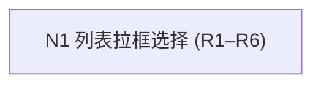

# Requirement Specification: Nemo 风格拉框选择（列表视图）

## 1. Goal and Context

| Item | Content |
|---|---|
| Current problem or motivation | tern 列表视图只能单选/Ctrl 多选/Shift 范围选，缺少鼠标拉框（rubberband/marquee）批量选择；此前一版实现被移除，现按 nemo 语义重新实现 |
| Target state | 列表视图空白处按住左键拖动出现半透明选框，实时更新选中集合；Ctrl/Shift+拉框保留原有选择并在框内反转 |
| Applicable users, systems, or scenarios | tern 文件管理器列表视图（List），Grid 视图暂不涉及 |
| Existing environment or context | `src/browser/marquee.rs` 仅存 `marquee_hit_row`（右键行命中）；`src/browser/table/mod.rs` 交互状态完备（selected_ids/anchor/pressed_was_selected/dragging + row_press/row_click/drag_select_row/set_dragging）；`src/browser/view/layout.rs` render_table_panel 已有 table_bounds canvas 与右键 capture |

## 2. Scope Boundary

| In Scope | Out of Scope |
|---|---|
| 列表视图空白处拉框选择 | Grid 视图拉框 |
| 拉框矩形绘制（accent 半透明） | 拖放行为变更（dnd 保持现状） |
| Ctrl/Shift+拉框 XOR 基准语义 | Alt 特殊语义（nemo 中 Alt 不参与选择） |
| 拉框与行拖拽/行选择的触发区分 | 键盘选择 |
| 拉框期间右键上下文目标清理 | — |

## 3. Requirements

| ID | Requirement Statement | Goal or Rationale | Applicable Scope | Priority |
|---|---|---|---|---|
| R1 | 列表视图空白处左键按下并拖动时显示拉框矩形（accent 0.15 填充+边框），随光标实时更新 | 直观批量框选 | browser_view.rs | P0 |
| R2 | 拉框按下时：无 Ctrl/Shift → 清空现有选择（基准为空）；有 Ctrl/Shift → 保留现有选择为基准 | nemo `start_rubberbanding` 语义 | browser.rs + browser_view.rs | P0 |
| R3 | 拉框拖动中，选中集合 = 基准中框外行 ∪ (框内行 XOR 基准)，即框内反转、框外保留，实时应用 | nemo `rubberband_select` `is_in ^ was_selected_before_rubberband` | marquee.rs + browser.rs | P0 |
| R4 | 已选中项上按下→不触发拉框（走 dnd 拖拽）；未选中项上按下→不触发拉框（走现有 row_press 行选择）；仅空白按下触发拉框 | 与现有行交互/dnd 无冲突 | browser_view.rs | P0 |
| R5 | 拉框开始清空右键上下文目标与 anchor；拉框结束（mouse_up）重置选择模式为 Idle | 交互状态一致性（菜单目标不残留） | browser.rs | P1 |
| R6 | 拉框期间目录切换/重建 visible 后状态不残留（rebuild_visible 已 retain 选中集；marquee 结构随 BrowserView 存亡） | 切目录不残留选框 | browser.rs | P2 |

## 4. Rules and Scenarios

- 触发判定：`marquee_hit_row` 返回 None（空白）才 `begin_marquee`；行上按下交由行元素自身 `row_press`/dnd 处理。
- XOR 语义：`marquee.was_selected`（按下时选择快照）为基准；每次 mouse_move 用基准计算，而非增量，保证多次 move 结果一致。
- mouse_up：清 marquee、`end_marquee` 置 Idle。
- 与 dnd 并存：拉框只在空白，行拖拽只在行，无交叠。

## 5. Constraints and Impact

- 行命中依赖 `table_bounds`（canvas 记录）与 `vertical_scroll_handle.offset()`，滚动后拉框命中需含滚动偏移（现有 `row_bounds` 已处理）。
- 拉框状态放 `BrowserView.marquee: Option<Marquee>`（非持久化，不进 dock 序列化）。
- 修改文件：`src/browser/marquee.rs`（Marquee 结构+marquee_apply）、`src/browser/table/mod.rs`（begin/end_marquee + Marquee 选择模式）、`src/browser/view/layout.rs`（事件接线+矩形层）。

## 6. Assumptions and Open Questions

### Assumptions

- 仅空白按下触发拉框（nemo 语义；上次"未选中行上按下也可拉框"的改法随后被整体回滚，本次回归 nemo 原始语义）。
- Grid 视图不做（用户此前明确"先只实现列表"）。
- 拉框期间 auto-scroll（拖到视口边缘自动滚动）暂不实现，nemo 有但属增强项。

### Open Questions

- 无阻塞问题。

## 7. Lightweight Predesign

| Requirement | Module or Responsibility | Key Structural Change | Coupling with Other Requirements | Initial Recommendation |
|---|---|---|---|---|
| R1 | `browser_view.rs` render_table_panel | 重新加 mouse_down/move/up 事件 + marquee_layer 矩形 + `BrowserView.marquee` 字段 | 与 R4 同一事件块 | 合并 N1 |
| R2 | `browser.rs` + `browser_view.rs` | `begin_marquee()` 返回按下时选择快照作基准 | 与 R3 共享基准 | 合并 N1 |
| R3 | `marquee.rs` | `Marquee{anchor,current,was_selected}` + `marquee_apply` XOR 基准 | 依赖 R2 的基准 | 合并 N1 |
| R4 | `browser_view.rs` | 空白判定复用 `marquee_hit_row`；行事件不动 | 与 R1 同一接线 | 合并 N1 |
| R5 | `browser.rs` | begin/end_marquee 清 context_target/anchor、置 Idle | 与 R2 同一方法 | 合并 N1 |
| R6 | 既有 `rebuild_visible` retain + BrowserView 生命周期 | 无新增结构 | 无 | 随 N1 验证即可 |

### Reference Project Basis

| Requirement | Reference Entry Point | Reference Flow | Reusable Behavior | Project-Specific Parts |
|---|---|---|---|---|
| R2/R3 | `nemo-icon-container.c: start_rubberbanding / rubberband_select` | 按下记录 `was_selected_before_rubberband`；拖动 `is_in ^ was_selected` | XOR 基准语义 | 行命中（几何）替代图标命中 |
| R4 | `nemo-icon-container.c: button_press_event` | 空白（非 icon）才 start_rubberbanding | 触发判定 | 复用 `marquee_hit_row` |

### Target Project State

| Requirement | Target Module | Existing Capability | Missing Capability | Adaptation Direction |
|---|---|---|---|---|
| R1–R5 | `marquee.rs` / `browser.rs` / `browser_view.rs` | 行命中、交互状态、行选择/dnd | Marquee 结构、XOR 应用、事件接线、矩形渲染 | 恢复并接线上一版被移除的实现骨架，基准语义对齐 nemo |

## 8. Requirement Implementation DAG

| Node | Requirements | Predesign Basis | Dependencies | Layer |
|---|---|---|---|---|
| N1 | R1, R2, R3, R4, R5, R6 | 单一编译单元（三文件）顺序迭代，状态结构共享 | - | 1 |

### Layer Order

1. Layer 1: N1
